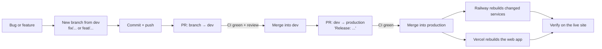

# Release workflow: from a bug report to a fix in production

This explains how a change, whether a bug fix, feature or config change, travels from your
machine to the live site. It covers the branches, the pull requests (PRs), what CI checks, and
what deploys automatically. The last section walks through a real bug we fixed this way, step by
step.

For first-time platform setup (Railway, Vercel, Supabase), see [DEPLOYMENT.md](DEPLOYMENT.md).

---

## 1. The big picture



The one rule behind everything: **`production` is what's live.** Railway and Vercel both watch the
`production` branch and deploy every push to it. Nothing reaches users until it's merged there.

---

## 2. Branches

| Branch | Purpose | Who writes to it |
|---|---|---|
| `production` | **Live code.** Every push to it deploys. | Only release PRs from `dev` (or an emergency hotfix, see §7). Never commit to it directly. |
| `dev` | **Integration branch.** Finished work collects here and is tested together before release. | Only PRs from short-lived work branches. |
| `fix/…`, `feat/…`, `docs/…`, `refactor/…`, `chore/…` | **Work branches.** One per piece of work, created from `dev`, deleted after merge. | You. |

Name work branches after what they do, for example `fix/cross-site-gateway-auth`,
`feat/deploy-railway-vercel` or `docs/release-workflow`. The prefix tells reviewers the kind of
change at a glance.

Why the extra `dev` step instead of PRs straight into `production`?
- **Batching:** several fixes and features can be checked together and released together.
- **A safe place for mistakes:** if a merge into `dev` breaks something, the live site is unaffected.
- **Readable history:** each "Release" PR into `production` lists exactly what went live and when.

---

## 3. What runs automatically

### On every pull request: CI ([`.github/workflows/ci.yml`](../.github/workflows/ci.yml))

CI also runs on every push to `dev` and `production`. It first works out what changed, then runs
only the jobs that matter.

| Job | Runs when | What it does |
|---|---|---|
| `changes` | always | Detects whether `apps/web`, `services/` or `packages/` (or turbo/package/workflow files) changed. |
| `quality` | anything in code changed | `bun install`, then **lint**, **type-check** and **tests** across the monorepo. |
| `build-web` | web or shared packages changed | Builds the Next.js app. |
| `build-services` | services or shared packages changed | Builds each of the 6 services, one matrix job per service. |

On top of that, **Vercel** comments on each PR and builds a **preview deployment** of the web app.
The preview proves the web app builds on Vercel. Its URL can't actually use the production backend,
because the gateway's CORS only allows `https://yome-nine.vercel.app`.

**Merge only when every check is green.**

### On merge into `production`: deployments

| What | Triggered by | What happens |
|---|---|---|
| **Railway**: the 6 backend services | Push to `production` | Each service rebuilds from `Dockerfile.service`, but only if its **watch paths** match the change (`/services/<name>/**`, `/packages/**`, `/Dockerfile.service`, `/bun.lock`). For example, a gateway-only fix rebuilds only the gateway. |
| **Railway**: core's pre-deploy step | Every core deploy | Runs `bun run --cwd packages/database db:migrate` **before** the new version goes live, which applies new database migrations automatically. If it fails, the old version keeps running. |
| **Railway**: health check | Every deploy | The new version must answer `/health` on its `PORT` before traffic switches over. Otherwise the deploy fails and the old version stays live. |
| **Vercel**: the web app | Push to `production` | Builds and replaces `yome-nine.vercel.app`. `NEXT_PUBLIC_*` variables are baked in at this point. |
| GitHub Actions: `deploy-services.yml` | Push to `production` touching `services/`, `packages/` or the Dockerfile | Builds and pushes service images to GHCR (`ghcr.io/<owner>/yome-<service>`). This is a **backup artifact**; Railway builds its own images and doesn't use these. |
| GitHub Actions: `deploy-web.yml` | Push to `production` touching `apps/web/` or `packages/` | Builds the web app. It only deploys if `VERCEL_*` secrets are set in GitHub, which they deliberately aren't, because Vercel's Git integration already deploys. So in practice it's just a build check. |

---

## 4. Step by step: fixing something

Every change follows the same six stages: report, investigate, fix, review into `dev`, release, verify.

### Stage 1: Notice and reproduce
- Write down **what you saw**, **where** (which URL or page) and **what you expected**. Include
  screenshots and the browser console's error messages.
- Decide whether it happens **only in production** or also locally. That one fact narrows the
  cause a lot:
  - **Only in production** usually means configuration: env vars, domains, cookies, CORS, or the
    order things deploy in.
  - **Locally too** usually means a code bug.

### Stage 2: Investigate
- **Browser:** DevTools → Network shows which request failed, with its status (401, 404, 500…)
  and response body.
- **Backend:** Railway → the service → **Deployments → Deploy Logs**. Build failures are under
  **Build Logs**.
- **Web:** Vercel → **Deployments → the deployment → Logs**.
- Reproduce the failing request directly with `curl` against the live gateway when you can.
  Seeing the same error outside the browser confirms the cause.
- **Find the root cause before writing a fix.** A guess that happens to work can hide the real problem.

### Stage 3: Fix on a work branch
```bash
git fetch origin
git switch -c fix/<short-description> origin/dev
```
Always start from the **latest `dev`**, so you aren't fixing old code.

Make the change, and **add a test** that would have caught the bug. Then run the same checks CI
will run:
```bash
bun run lint
bun run check-types:all
bun run test
```
If the change touches a service, also build its Docker image once:
```bash
docker build -f Dockerfile.service --build-arg SERVICE_DIR=services/gateway .
```
Then commit with a message that explains **why**, not just what:
```bash
git add <files>
git commit -m "fix(auth): <what was wrong and why this fixes it>"
git push -u origin fix/<short-description>
```

### Stage 4: PR into `dev`
- Open the PR with **base `dev`**:
  ```bash
  gh pr create --base dev
  ```
- In the description, give the problem, the root cause, the fix and a test plan.
- Wait for **CI to go green** and for the Vercel preview to build. If CI fails, push fixes to the
  same branch; the PR updates itself.
- **Merge** with a merge commit, as the repo's history does. You can delete the work branch afterwards.

### Stage 5: Release PR from `dev` into `production`
- Open a PR with **base `production`** and **head `dev`**, titled `Release: <summary>`:
  ```bash
  gh pr create --base production --head dev --title "Release: <summary>"
  ```
- In the description, list what's going out and **what will redeploy**. For example: "Railway:
  gateway only. Vercel: web app. No env var changes."
- Before merging, think about **order and config**:
  - **New env vars?** Add them in Railway or Vercel *before* merging. A service whose new code
    needs a variable that isn't set will crash on boot.
  - **Database migration?** Core's pre-deploy step applies it first. Keep migrations
    **backward-compatible**: add columns or tables first, and remove old ones in a later release.
    For a few minutes, the other services may still run old code against the new schema.
  - **A new `NEXT_PUBLIC_*` variable?** It needs a Vercel rebuild, which merging triggers.
- Wait for green CI, then **merge**. This is the moment it goes live.

### Stage 6: Verify in production
- Watch Railway (the affected services go **Building → Deploying → Online**) and Vercel (**Ready**).
- Check the health endpoints: `https://gateway-pr.up.railway.app/health` and
  `https://messaging-pro.up.railway.app/health`.
- **Repeat the exact steps from Stage 1** on `yome-nine.vercel.app` and confirm they're fixed.
- Check that nearby features still work: sign-in, dashboard, chat, uploads.

### After a release: bring `dev` back in line with `production`
Each release adds a merge commit to `production` that `dev` doesn't have. GitHub then reports
`dev` as "behind" `production`. It's harmless, but it adds up. Merge `production` back into `dev`
now and then:
```bash
git fetch origin
git switch dev
git pull
git merge origin/production
git push
```
This changes no files, only history. Afterwards, both branches point at the same code.

---

## 5. Rolling back when a release breaks production

Act in this order. Speed matters more than elegance.

1. **Instant rollback on the platform** (seconds, no Git needed):
   - **Vercel:** Project → **Deployments**, find the last good deployment, then **Instant Rollback**
     (or **⋮ → Promote to Production**).
   - **Railway:** the broken service → **Deployments**, find the last good deployment, then
     **⋮ → Redeploy**.
2. **Then fix it properly in Git**, so the next push doesn't bring the bug back:
   - Either revert the release, which creates a new commit undoing it (needs a PR into
     `production`, then back-merge into `dev`):
     ```bash
     git revert -m 1 <release-merge-commit>
     ```
   - Or fix forward with a normal fix branch, following §4.
3. **Database migrations can't be rolled back by redeploying.** If a migration caused the
   problem, write a new migration that corrects it. This is why migrations should be
   backward-compatible.

---

## 6. Changes that aren't code

Not everything goes through Git. These are made in a dashboard, so there's no PR to review them.
**Write down what you changed**, for example in the PR or release notes.

| Change | Where | Takes effect |
|---|---|---|
| Backend env var (secret, URL, feature flag) | Railway → service → Variables, or Project Settings → Shared Variables | After the service redeploys. Railway stages the change; click **Deploy**. |
| Web env var | Vercel → Settings → Environment Variables | Only after a **redeploy**. `NEXT_PUBLIC_*` values are compiled into the JavaScript at build time. |
| Service settings (health check, pre-deploy, watch paths, domains) | Railway → service → Settings | On the next deploy. |
| Seed or demo data | Local stack pointed at Railway's `DATABASE_PUBLIC_URL` (see DEPLOYMENT.md §3.6) | Immediately. **Switch `.env` back** to the local database straight away afterwards. |

Secrets shared between platforms **must match exactly**: `NEXTAUTH_SECRET` and
`GATEWAY_SHARED_TOKEN` on Railway and Vercel. To rotate one, update both, then redeploy both.

---

## 7. Emergency hotfix (when `dev` isn't releasable)

Normally fixes go through `dev`. But if `dev` holds unfinished work you don't want to ship yet,
and production is broken:

```bash
git switch -c hotfix/<desc> origin/production
```
1. Fix, test and push, as in Stage 3.
2. Open a PR with **base `production`**, wait for green CI, then merge. It's live.
3. **Immediately** bring the fix into `dev` as well, by merging `production` into `dev` (see
   "After a release" above). If you skip this, the next release from `dev` silently undoes the
   hotfix.

Use this rarely. The `dev` route is safer because the fix gets tested alongside everything else.

---

## 8. Worked example: "Unable to identify the current user" (PRs #8 and #9)

This is exactly how the first production bug was handled.

**1. Report.** After the first deploy, sign-in worked on `yome-nine.vercel.app`. But the
dashboard said *"Unable to identify the current user"*, Messages said *"User not found. Please
login again"*, and connections were empty. The navbar still showed the signed-in user.

**2. Only in production.** Locally everything worked, which pointed at the deployment setup
rather than the feature code.

**3. Investigate.**
- **The code:** the web app's API calls used `axios` with `withCredentials: true`, so they relied
  on the NextAuth **session cookie** to prove who the user is.
- **Reproduced with `curl`:** `POST https://gateway-pr.up.railway.app/api/auth/get-user` without
  that cookie returned **401 "Missing auth token"**. The browser was getting the same 401.
- **Root cause:** the cookie belongs to `yome-nine.vercel.app`, and browsers don't send it to a
  *different site* (`*.up.railway.app`). Locally both run on `localhost`, where cookies are shared
  across ports, which is why it never showed up in development.

**4. Fix** on `fix/cross-site-gateway-auth`, branched from `dev`:
- **Gateway** (`services/gateway/src/middleware/auth.ts`): also accepts a short-lived token
  (5 minutes, signed with `NEXTAUTH_SECRET`). This is the same kind of token live chat already
  used, from `/api/auth/socket-token`.
- **Web** (`apps/web/lib/auth/gatewayAccessToken.ts`): an axios interceptor adds that token as
  `Authorization: Bearer …` to every gateway request.
- **Tests:** unit tests on both sides, plus an end-to-end check with a locally built gateway and
  identity:
  - with the token → 200;
  - without it → 401;
  - with a tampered token → 401.

**5. PR #8: `fix/cross-site-gateway-auth` → `dev`.** It described the problem, root cause and fix,
plus the test plan. CI went green, and it was merged.

**6. PR #9: `dev` → `production`, "Release: fix sign-in across Vercel and Railway".**
- **What would redeploy:** only the gateway on Railway, since only `services/gateway` changed,
  plus the web app on Vercel.
- **Config:** no env var changes. Merging it put the fix live.

**7. Verify.** Sign in on `yome-nine.vercel.app`, and check that the dashboard, connections and
chat load data.

The general lesson: **"works locally, breaks in production" is usually about the differences
between the two environments.** Here that was one site versus two sites. In other cases it might
be HTTP versus HTTPS, missing env vars, or private versus public networking. Look there first.

---

## Quick reference

```bash
# start a fix or feature
git fetch origin
git switch -c fix/<desc> origin/dev

# check locally before pushing
bun run lint
bun run check-types:all
bun run test

# open the PR into dev
git push -u origin fix/<desc>
gh pr create --base dev

# release dev to production
gh pr create --base production --head dev --title "Release: <summary>"

# after a release: bring dev in line with production
git switch dev
git pull
git merge origin/production
git push
```
