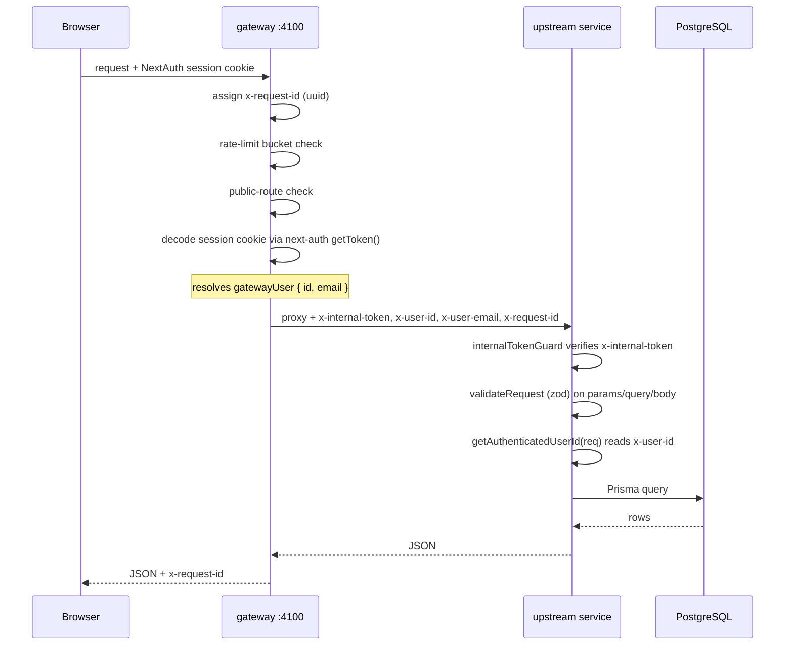
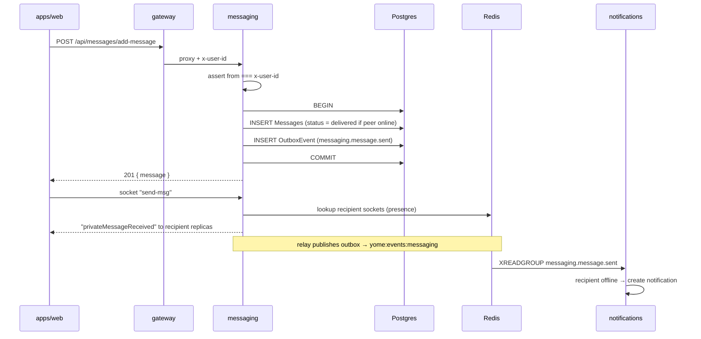
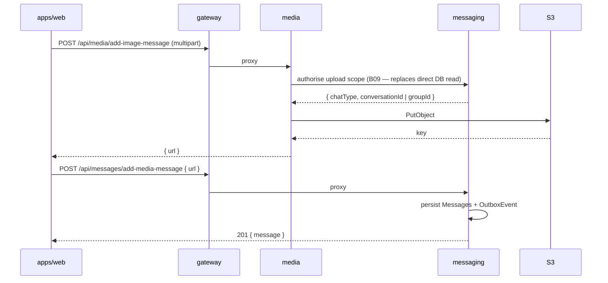
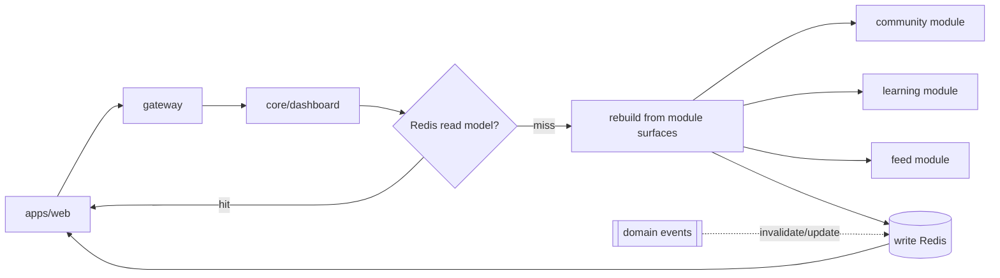

# Yome API and Data Flow Plan

## Purpose

`architecture-plan.md` defines who owns what code. `data-architecture-plan.md` defines where
data lives. `event-architecture-plan.md` defines the asynchronous backbone. This document
defines the **synchronous surface**: every endpoint, who owns it, what it touches, how
services are allowed to call each other, and how a request flows end to end.

Two invariants govern everything here:

1. **External API paths do not change.** `apps/web/utils/ApiRoutes.ts` is the contract. The
   gateway's upstream targets change during the refactor; the browser's view does not.
2. **The gateway is the only synchronous entry point.** Downstream services are protected by
   `internalTokenGuard` and must never be reachable directly from a browser.

## Request Flow Anatomy

Every authenticated REST request today follows this path
(`services/gateway/src/index.ts`):



Key properties to preserve through the refactor:

- **Identity is carried by header, not re-verified downstream.** Services trust `x-user-id`
  because `internalTokenGuard` proves the request came from the gateway. Every controller
  independently re-implements `getAuthenticatedUserId` reading `x-user-id`; this moves to
  `@repo/contracts` in B03.
- **Authorization is per-handler, not centralised.** Handlers compare `x-user-id` against the
  `loggedInUserId` path param and return `403` on mismatch. This pattern is repeated ~15 times
  in `services/user/src/controllers/user.controller.ts` and must be preserved verbatim when
  the controller is split — extract it as a shared `assertSelf(req, id)` guard.
- **`x-request-id` is generated at the edge and forwarded.** It becomes the `correlationId` on
  every domain event (`event-architecture-plan.md`), which is what makes a request traceable
  across its synchronous hops and the asynchronous work they spawn.

## Complete API Surface

Owner is the post-refactor module. "Store" lists the Prisma models touched. "Kind" is
`R` (read), `W` (write), `RW` (read then write).

### identity — credentials (external `/api/auth/*`)

| Method | External path | Owner | Kind | Models | Notes |
| --- | --- | --- | --- | --- | --- |
| POST | `/api/auth/get-user` | identity/credentials | R | User, UserProfile | Used by `ensureUserInfo` to resolve the session into an app user |
| POST | `/api/auth/verify-credentials` | identity/credentials | R | User | **Public route.** Called by NextAuth Credentials provider |
| POST | `/api/auth/register-user` | identity/credentials | W | User, UserProfile | **Public route.** Emits `identity.user.registered` (B13) |
| POST | `/api/auth/oauth-user` | identity/credentials | W | User, UserProfile | Upsert on OAuth sign-in. Emits `identity.user.registered` when new |
| POST | `/api/auth/change-password` | identity/credentials | RW | User | Emits `identity.user.password_changed` |

### identity — profile (external `/api/user/*`, three paths only)

| Method | External path | Owner | Kind | Models | Notes |
| --- | --- | --- | --- | --- | --- |
| POST | `/api/user/get-user-by-id` | identity/profile | R | User, UserProfile | Moves from `services/user` in B05 |
| POST | `/api/user/update-user` | identity/profile | W | User, UserProfile | Multipart; avatar → S3 via `@repo/storage`. Emits `identity.user.profile_updated` |
| GET | `/api/user/get-all-users` | identity/profile | R | User | Unbounded list — add pagination in B05 |

These three paths are the reason the gateway needs **sub-path routing within `/api/user`**
(see "Gateway Route Manifest" below). It is the single most delicate piece of B05.

### core/community (external `/api/user/*`)

| Method | External path | Owner | Kind | Models | Notes |
| --- | --- | --- | --- | --- | --- |
| GET | `/api/user/groups/discover` | community | R | Group, GroupTag | `ILIKE` search — search-index candidate (T-04) |
| GET | `/api/user/groups/joined/:loggedInUserId` | community | R | Group | |
| GET | `/api/user/groups/invitations/:loggedInUserId` | community | R | GroupInvitation, Group | |
| GET | `/api/user/groups/:id` | community | R | Group, User, GroupAnnouncement, GroupEvent, **Resource** | **Cross-module read into learning** |
| POST | `/api/user/groups` | community | W | Group, GroupTag | Emits `community.group.created` |
| POST | `/api/user/groups/:id/join` | community | W | Group members | Emits `community.group.member_joined` |
| GET | `/api/user/get-all-groups` | community | R | Group | Unbounded — add pagination |
| GET | `/api/user/get-connected-groups/:loggedInUserId` | community | R | Group | |
| GET | `/api/user/get-unassociated-groups/:loggedInUserId` | community | R | Group | Contains the `groupData` fixture fallback removed in B04 |
| POST | `/api/user/connect-user-to-group` | community | W | Group members | Emits `community.group.member_joined` |
| GET | `/api/user/connections/summary/:loggedInUserId` | community | R | User, Group (counts) | |
| GET | `/api/user/connections/suggestions/:loggedInUserId` | community | R | User, Group | |
| GET | `/api/user/connections/following/:loggedInUserId` | community | R | User (following) | |
| GET | `/api/user/get-connected-users/:loggedInUserId` | community | R | User (following) | |
| GET | `/api/user/get-unfollowed-mentors/:loggedInUserId` | community | R | User | |
| POST | `/api/user/connect-user-to-mentor` | community | W | User (following) | Emits `community.connection.followed` |

### core/learning (external `/api/user/*` and `/api/resources/*`)

| Method | External path | Owner | Kind | Models | Notes |
| --- | --- | --- | --- | --- | --- |
| GET | `/api/user/events` | learning | R | **GroupEvent** | **Cross-module read into community** |
| GET | `/api/user/projects` | learning | R | **Post** (`kind="Project"`) | **Cross-module read into feed.** "Projects" is a view, not a model |
| GET | `/api/user/projects/:id` | learning | R | **Post** | Same |
| GET | `/api/resources` | learning | R | Resource, ResourceSave, ResourceHelpfulVote | Cursor-paginated. `ILIKE` search — T-04 candidate |
| GET | `/api/resources/:id` | learning | R | Resource (+ related) | |
| POST | `/api/resources` | learning | W | Resource | Emits `learning.resource.created` |
| POST | `/api/resources/:id/save` | learning | W | ResourceSave, Resource.saveCount | Transactional counter. Emits `learning.resource.saved` |
| DELETE | `/api/resources/:id/save` | learning | W | ResourceSave, Resource.saveCount | Emits `learning.resource.unsaved` |
| POST | `/api/resources/:id/helpful` | learning | W | ResourceHelpfulVote, Resource.helpfulCount | Emits `learning.resource.marked_helpful` |

### core/dashboard (external `/api/user/*`)

| Method | External path | Owner | Kind | Models | Notes |
| --- | --- | --- | --- | --- | --- |
| GET | `/api/user/dashboard/:loggedInUserId` | dashboard | R | User, Post, StudyRoom, GroupEvent, Topic, Group | **7 parallel queries in one `Promise.all`.** The read-model target (T-03/B15) |

### messaging (external `/api/messages/*` and `/api/chat/*`)

| Method | External path | Owner | Kind | Models | Notes |
| --- | --- | --- | --- | --- | --- |
| GET | `/api/messages/get-messages/:from/:to/:chatType` | messaging/messages | RW | Messages, Conversation | Read marks unread as `read` — a GET with a side effect |
| POST | `/api/messages/get-or-create-direct-conversation` | messaging/messages | W | Conversation | Emits `messaging.conversation.created` |
| POST | `/api/messages/add-message` | messaging/messages | W | Messages, Conversation | Emits `messaging.message.sent` |
| POST | `/api/messages/add-media-message` | messaging/messages | W | Messages | Called after the media upload completes |
| GET | `/api/messages/get-initial-group-messages/:userId` | messaging/messages | R | Group, Messages | |
| GET | `/api/messages/get-initial-contacts/:from` | messaging/messages | RW | Messages, User | Bulk-updates `sent` → `delivered` |
| POST | `/api/chat/validate-direct-conversation` | messaging/calls | R | Conversation, **User.following** | **Cross-domain read into community** |
| POST | `/api/chat/prepare-direct-call-conversation` | messaging/calls | RW | Conversation, **User.following** | Same |

### media (external `/api/media/*`)

| Method | External path | Owner | Kind | Models | Notes |
| --- | --- | --- | --- | --- | --- |
| POST | `/api/media/add-audio-message` | media | W | S3 + **Conversation/Group read** | The DB read is removed in B09 |
| POST | `/api/media/add-image-message` | media | W | S3 + **Conversation/Group read** | Same |

### notifications (external `/api/notifications/*`)

| Method | External path | Owner | Kind | Models | Notes |
| --- | --- | --- | --- | --- | --- |
| POST | `/api/notifications/send` | notifications | — | none | Stub returning `202`. Becomes event-driven in B14 |
| GET | `/api/notifications` | notifications | R | Notification | **New in B14** — `apps/web` `/notifications` has no data source today |
| POST | `/api/notifications/:id/read` | notifications | W | Notification | **New in B14** |

### dev-only (external `/api/db/*`)

| Method | External path | Owner | Notes |
| --- | --- | --- | --- |
| POST | `/api/db/create-multiple-users` | identity/dev | Guarded by `ENABLE_DEV_SEED_ROUTES`; logic moves to `@repo/seed` in B04 |
| POST | `/api/db/create-multiple-groups` | identity/dev | Same |
| POST | `/api/db/create-multiple-resources` | identity/dev | Same |
| POST | `/api/db/create-dashboard-demo-data` | identity/dev | Same |
| POST | `/api/db/deleteAll` | identity/dev | Also requires `DEV_SEED_ROUTE_TOKEN` |

### Socket.IO (direct to messaging :4103, bypasses gateway)

WebSocket cannot traverse the HTTP proxy gateway, so `apps/web` connects directly using
`NEXT_PUBLIC_CHAT_SOCKET_URL`. Authentication is a short-lived JWT minted by
`apps/web/app/api/auth/socket-token/route.ts` and verified against `NEXTAUTH_SECRET`.

| Event | Direction | Purpose | Post-B11 change |
| --- | --- | --- | --- |
| `add-user` | client → server | Register presence | Writes to Redis instead of the in-process `Map` |
| `join room` | client → server | Join a group room after membership check | Unchanged |
| `send-msg` | client → server | Fan out an already-persisted message | Routing via `@socket.io/redis-adapter` |
| `privateMessageReceived` | server → client | Direct message push | Cross-replica after B11 |
| `msg-receive` | server → client | Group message push | Cross-replica after B11 |
| `mark-read` / `mark-read-receive` | both | Read receipts | Cross-replica after B11 |
| `online-users` | server → client | Presence broadcast | Sourced from Redis |
| `signout` / `disconnect` | client → server | Presence teardown | Redis + TTL expiry |

## The `apps/web` Server-Side Surface

`apps/web` is not purely a frontend. It ships `axios`, `jsonwebtoken`, `@stream-io/node-sdk`,
`next-auth`, backend service URLs, and **backend secrets**. Any API catalogue that ignores it
is incomplete.

| Route / action | What it does | Verdict |
| --- | --- | --- |
| `app/api/auth/[...nextauth]/route.ts` + `options.ts` | NextAuth handler; Credentials provider posts to `/api/auth/verify-credentials` through the gateway | **Correct.** The web app owns the browser session; this is its job |
| `app/api/auth/session/route.ts` | Returns the decoded session | **Correct** |
| `app/api/auth/socket-token/route.ts` | Mints a 5-minute JWT signed with `NEXTAUTH_SECRET` for the Socket.IO handshake | **Acceptable.** The web app owns the session, so it is the natural minter. `messaging` verifies with the same secret. Revisit only if session ownership moves |
| `app/api/auth/sync-user/route.ts` | Upserts an OAuth user via the gateway | **Correct path, unsafe fallback.** When `NODE_ENV !== "production"` it accepts `email`/`name`/`image` **from the request body with no session** — an account-takeover primitive if `NODE_ENV` is unset in a deployed environment (issue #28, fixed in B02) |
| `app/api/dev/db/*` + `_lib/devDbProxy.ts` | Proxies dev seed calls to the gateway | **Correct.** Dev-only, gated |
| `middleware.ts` | `withAuth` route protection | **Correct**, but carries a `visual-qa=1` bypass gated on dev + localhost (issue #29 — audit in B02) |
| **`actions/stream.actions.ts`** | Mints Stream video tokens with `STREAM_SECRET_KEY`; upserts participants into Stream; **calls `CHAT_SERVICE_URL` directly, forging `x-internal-token` from `GATEWAY_SHARED_TOKEN` and `x-user-id`** | **Violation.** See below |

### The gateway-bypass violation

`stream.actions.ts` breaks the invariant stated at the top of this document — that the gateway
is the only synchronous entry point — in three ways at once:

1. **It bypasses the gateway.** It talks to `services/chat` on `CHAT_SERVICE_URL` directly, so
   the request never passes gateway rate limiting, session decoding, or request-id assignment.
2. **It impersonates the gateway.** It sets `x-internal-token: GATEWAY_SHARED_TOKEN` and
   `x-user-id` itself. `internalTokenGuard` cannot distinguish this from a real gateway call,
   which means the shared token's security value is only as strong as the frontend deploy.
3. **It holds backend secrets.** `STREAM_SECRET_KEY` and `GATEWAY_SHARED_TOKEN` are in the web
   app's environment. A compromised or misconfigured frontend deploy leaks both.

It also means **video calling has no service owner** — token minting, participant
provisioning, and call authorization are a Next.js server action rather than a domain module.

**Target (B09):** the Stream server logic moves into `services/messaging/src/modules/calls`
and is exposed through the gateway:

| Method | External path | Owner | Replaces |
| --- | --- | --- | --- |
| POST | `/api/chat/call-token` | messaging/calls | `tokenProvider()` in `stream.actions.ts` |
| POST | `/api/chat/call-participants` | messaging/calls | `ensureDirectCallUsers()` in `stream.actions.ts` |
| POST | `/api/chat/prepare-direct-call-conversation` | messaging/calls | already a service endpoint; `apps/web` stops calling it directly |
| POST | `/api/chat/validate-direct-conversation` | messaging/calls | same |

After B09, `apps/web` keeps only `NEXT_PUBLIC_STREAM_API_KEY` (a public client key) and drops
`@stream-io/node-sdk`, `STREAM_SECRET_KEY`, `GATEWAY_SHARED_TOKEN`, and `CHAT_SERVICE_URL`.
The acceptance check is mechanical: `grep -r "x-internal-token" apps/web` must return nothing.

## Gateway Route Manifest

The hardcoded `app.use("/api/...", proxyRequest(...))` list becomes
`services/gateway/src/routes/route-manifest.ts` (B10). Order matters: the three identity
profile paths must be matched **before** the general `/api/user` rule.

```ts
export const routeManifest: RouteRule[] = [
  { prefix: "/health",                        upstream: null,          public: true },
  { prefix: "/api/auth/register-user",        upstream: "identity",    public: true },
  { prefix: "/api/auth/verify-credentials",   upstream: "identity",    public: true },

  // Identity profile paths — MUST precede the general /api/user rule.
  { prefix: "/api/user/get-user-by-id",       upstream: "identity" },
  { prefix: "/api/user/update-user",          upstream: "identity" },
  { prefix: "/api/user/get-all-users",        upstream: "identity" },

  { prefix: "/api/auth",                      upstream: "identity" },
  { prefix: "/api/user",                      upstream: "core"     },
  { prefix: "/api/resources",                 upstream: "core"     },
  { prefix: "/api/messages",  upstream: "messaging", rewrite: "/api/chat" },
  { prefix: "/api/chat",                      upstream: "messaging" },
  { prefix: "/api/media",                     upstream: "media"     },
  { prefix: "/api/notifications",             upstream: "notifications" },
  { prefix: "/api/db",                        upstream: "identity", devOnly: true },
];
```

A route-manifest unit test must assert that every path in
`apps/web/utils/ApiRoutes.ts` resolves to exactly one rule, and that the three profile paths
resolve to `identity` rather than `core`. This is the regression guard for B05.

## Synchronous vs Asynchronous Decision Rule

| Use synchronous (HTTP through the gateway) when | Use asynchronous (domain event) when |
| --- | --- |
| The caller needs the result to render the response | The caller does not need a result |
| The operation must be atomic with the request | The work can complete after the response |
| The client is waiting | A side effect fans out to unknown consumers |
| Failure must fail the user's request | Failure should retry independently |

Applied to Yome:

- Fetching a group, resource, or message list → **synchronous**.
- Creating a group, post, or message → **synchronous write, asynchronous fan-out.** The write
  is transactional; the notification, dashboard update, and search index are events.
- Sending a notification → **always asynchronous.** A slow email provider must never slow a
  message send.
- Uploading media then persisting the message → **two synchronous calls today** (upload to
  `media`, then `add-media-message` to `messaging`). This stays synchronous because the client
  needs the URL before it can persist the message.

## Service-to-Service Call Rules

Synchronous service-to-service calls are the main source of latency coupling and cascading
failure. The allowed set is deliberately tiny.

| From | To | Allowed? | Mechanism |
| --- | --- | --- | --- |
| gateway | any service | **Yes** | HTTP proxy with `x-internal-token` |
| media | messaging | **Yes, one call only** | Upload-scope authorisation (B09), replacing the current direct DB read |
| any | any (other) | **No** | Use events, or an in-process module call within `core` |
| core module | core module | **Yes** | In-process call through `modules/<domain>/index.ts` only — never a direct Prisma query into another module's tables |
| any | notifications | **No sync calls** | Events only. The existing `POST /api/notifications/send` is retained for operational/manual sends, not for domain flows |
| `apps/web` | any service directly | **No** | Must go through the gateway. **Currently violated** by `actions/stream.actions.ts` (issue #25) — fixed in B09 |
| anything | forging `x-internal-token` | **Never** | Only the gateway sets it. `apps/web` currently does (issue #25); after B09 the token exists in exactly one deploy |

The rule that matters most: **`core` modules call each other in-process, not over HTTP.**
Cross-module reads 3, 4, and 5 in `data-architecture-plan.md` (community→learning,
learning→feed, learning→community) are cheap in-process calls precisely because these domains
share a process. This is the concrete payoff of the module-over-service decision in
`service-decomposition-plan.md`.

## Read Model / BFF Strategy

The dashboard is the only true BFF endpoint: it exists to serve one screen and aggregates four
domains. Its evolution:

| Stage | Implementation | Batch |
| --- | --- | --- |
| Today | 7 parallel Prisma queries in `services/user` | — |
| P1 | Same queries, moved to `core/modules/dashboard`, calling community/learning/feed module surfaces instead of querying their tables directly | B08 |
| P2 | Cache-aside in Redis, 60 s TTL | B12 |
| P4 | Materialised read model rebuilt from events; the fan-out query runs only on cold rebuild | B15 |

Rules for read models:

- A read model is **derived state and always disposable** — it must be fully rebuildable from
  the owning domains' tables plus the event stream.
- Read models never accept writes from clients.
- Per-viewer mutable flags (`isJoined`, `isSaved`, `isHelpful`, `isFollowing`) must **not** be
  baked into a shared cache entry. Cache the shared shape, resolve viewer flags per request.
  This is a live bug risk in B12: `mapGroupCard` and `mapResource` currently mix shared and
  per-viewer fields in the same object.

## Resilience Requirements

None of the following exists today. The gateway proxies with no timeout, no retry, and no
circuit breaker; an unresponsive upstream hangs the request until the socket dies.

| Concern | Requirement | Batch |
| --- | --- | --- |
| Upstream timeout | 5 s default, 30 s for `/api/media/*` uploads. Return `504` with the request id | B10 |
| Retry | Idempotent methods (GET/HEAD) only, 2 attempts, exponential backoff with jitter. **Never retry POST** without an idempotency key | B10 |
| Circuit breaker | Per-upstream. Open after 5 consecutive failures, half-open probe after 30 s. Return `503` while open | B10 |
| Idempotency keys | `Idempotency-Key` header accepted on message send and resource create; deduplicated in Redis for 24 h | B12 |
| Rate limiting | Redis-backed sliding window (currently per-replica in-memory) | B11 |
| Health checks | `/health` already exists on every service and is excluded from `internalTokenGuard`. `tests/contracts.smoke.mjs` must be extended to the post-refactor unit list | B02 / B10 |
| Graceful shutdown | Drain in-flight requests, `XACK` pending events, close socket connections on `SIGTERM` | B13 |
| Payload limits | Gateway accepts 20 MB; media enforces 15 MB audio / 10 MB image; avatars 5 MB. Keep the gateway limit above the largest downstream limit | — |

## Key Data Flows

### Sending a text message



Note the ordering: persistence is synchronous and transactional; realtime push is a separate
socket round trip; notification is asynchronous. The outbox row commits with the message, so a
rolled-back insert publishes nothing.

### Uploading and sending media



Two synchronous calls, because the client needs the URL before persisting. The media service
holds **no** database access after B09 — the scope check becomes its one permitted
service-to-service call.

### Reading the dashboard (after B15)



### Following a user, and its effect on messaging

```mermaid
sequenceDiagram
    participant W as apps/web
    participant G as gateway
    participant C as core/community
    participant DB as Postgres
    participant R as Redis Streams
    participant M as messaging

    W->>G: POST /api/user/connect-user-to-mentor
    G->>C: proxy
    C->>DB: BEGIN; connect following; INSERT OutboxEvent; COMMIT
    C-->>W: 200
    Note over C,R: relay → yome:events:community
    R->>M: community.connection.followed
    M->>M: update local follow projection
    Note over M: isConnectedDirectPeer now reads the<br/>projection instead of community tables
```

This is the flow that makes a future messaging database extraction possible. Until
`messaging-connections` exists, `isConnectedDirectPeer` reaches directly into community-owned
follow edges, and messaging cannot be split.

## Known API Issues to Fix During the Refactor

Found while cataloguing; each needs an owner batch.

| # | Issue | Location | Batch |
| --- | --- | --- | --- |
| 1 | `GET /api/messages/get-messages/...` mutates `messageStatus` — a GET with side effects, not safely retryable | messaging | B09 |
| 2 | `GET /api/user/get-all-users` and `/get-all-groups` are unbounded, no pagination | identity, community | B05, B06 |
| 3 | `getAuthenticatedUserId` duplicated in `auth`, `user`, `chat`, `resources` | 4 services | B03 |
| 4 | The `x-user-id` vs `loggedInUserId` `403` check is copy-pasted ~15 times | `user.controller.ts` | B06 |
| 5 | Inconsistent response envelopes — some `{ ok, ... }`, some bare (`{ users }`, `{ groups }`, `{ messages }`) | all services | B03 (define in `@repo/contracts`) |
| 6 | `joinGroupById` mutates `req.body` then delegates to another handler | community | B06 |
| 7 | No timeout, retry, or circuit breaking on any gateway proxy call | gateway | B10 |
| 8 | `tests/contracts.smoke.mjs` health list omits `resources` and will omit `core`/`identity`/`messaging` after the rename | tests | B02, B10 |
| 9 | `apps/web` `/notifications` route has no backing API at all | notifications | B14 |
| 10 | `User.notificationCount` and `User.learningStreakDays` are hardcoded schema defaults (`3`, `12`), not real data | identity, feed | B14 |

## Open Questions

| # | Question | Needed by |
| --- | --- | --- |
| 1 | Should the response envelope be standardised to `{ ok, data, error }` across all services? It is a breaking change for `apps/web` call sites | B03 |
| 2 | Pagination style for the unbounded list endpoints — cursor (as `/api/resources` already uses) or offset? | B05 |
| 3 | Does the media→messaging scope check become a real HTTP call, or does the gateway inject a signed scope claim? The latter avoids the only service-to-service dependency | B09 |
| 4 | Should Socket.IO eventually move behind the gateway via a WebSocket-aware proxy, or stay a direct connection? | after B11 |
